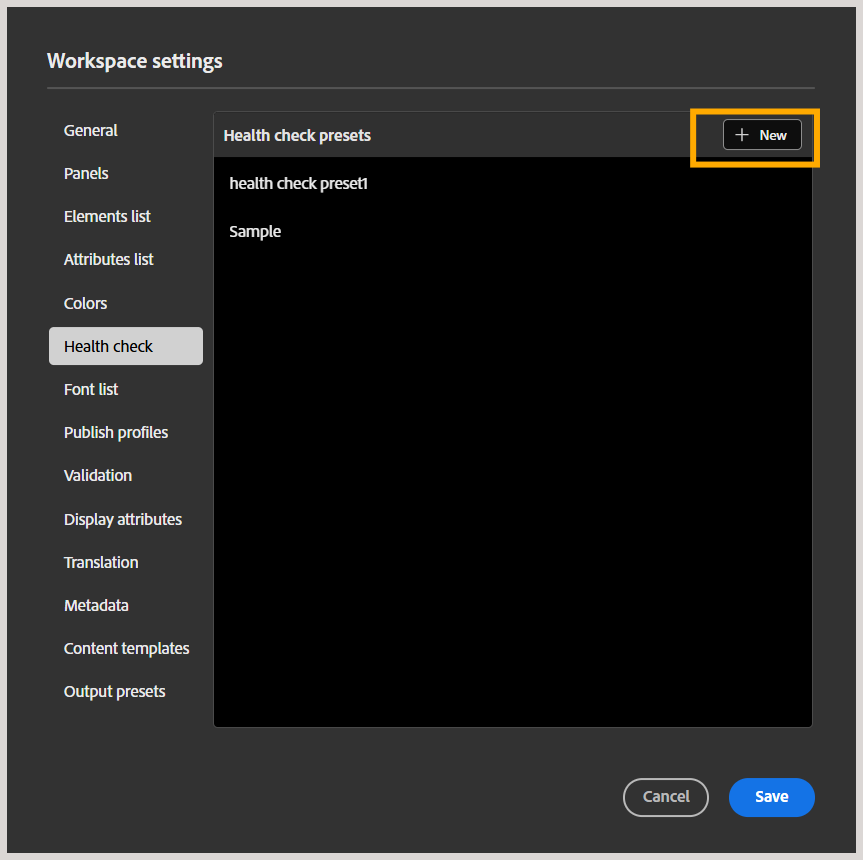
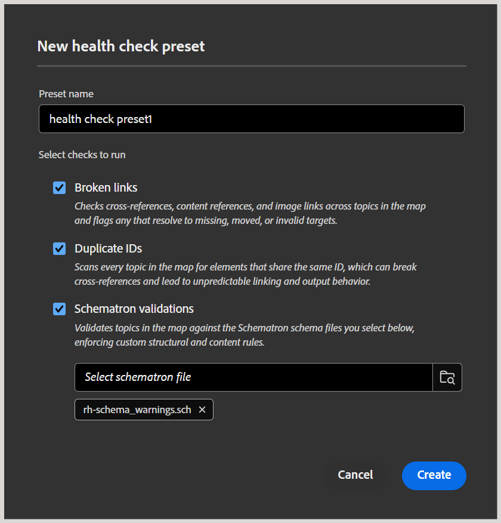
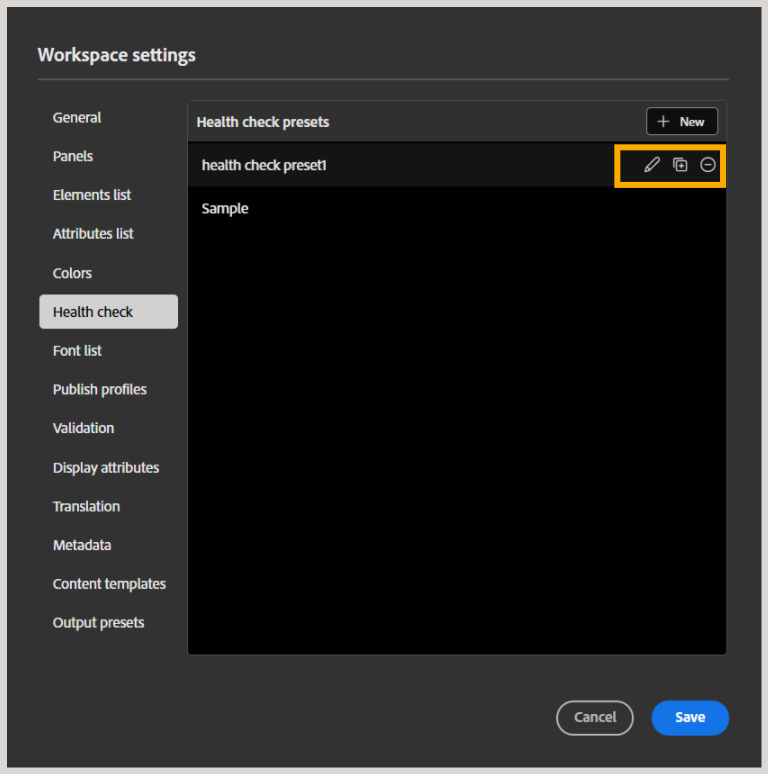

# 创建和管理运行状况检查预设

>[!NOTE]
>
> 此功能默认处于启用状态。 如果您不希望在您的环境中使用此功能，请联系您的客户成功团队。

作为管理员，您可以在Experience Manager中的文件夹配置文件级别配置运行状况检查功能，该功能允许作者和发布者对DITA映射运行运行状况检查。 这包括提前检测映射中的链接断开、ID重复和架构验证失败等问题，而不是单独检查每个文件，然后再发布。 运行哪些检查由运行状况检查预设定义，这是作者和发布者可以选择并运行的一组规则。

本文介绍了如何创建和管理运行状况检查预设。

## 创建运行状况检查预设

执行以下步骤以在文件夹配置文件级别创建运行状况检查预设：

1. 转到[Workspace设置](./workspace-settings.md)并从列表中选择&#x200B;**运行状况检查**。
1. 在&#x200B;**运行状况检查预设**&#x200B;面板中，选择&#x200B;**新建**。

   
1. 显示&#x200B;**新的运行状况检查预设**&#x200B;对话框。 添加预设名称并选择要包含的规则或检查 — 可用选项包括断开链接、重复ID和架构验证。

   
1. 选择&#x200B;**创建**。
1. 选择&#x200B;**保存**&#x200B;以保存设置。

此预设现在可供作者和发布者使用。 对于作者，该功能在“地图”视图中的地图的“选项”菜单中可用，并且位于与“搜索”面板一起的“运行状况检查”报表面板中，允许他们使用为其配置文件配置的运行状况检查预设之一在所选地图上运行运行状况检查。 有关详细信息，请在映射编辑器中查看[其他功能](../user-guide/map-editor-other-features.md#run-health-check-on-a-map)。

对于发布者，预设面板中会显示&#x200B;**在生成输出之前运行运行状况检查**&#x200B;切换开关，发布者可根据需要启用或禁用该切换开关。 启用后，运行状况检查报告将在发布过程开始时附加到日志，但不会阻止输出生成。

## 管理运行状况检查预设

创建预设后，该预设将添加到运行状况检查预设面板中，从中可以对预设执行编辑、复制或删除操作。

- **编辑**：允许您编辑预设字段，例如预设的名称、检查（选择或取消选择检查），以及添加或删除附加到预设的Schematron文件。
- **复制**：在同一列表中创建预设的副本。
- **移除**：从面板中移除预设。

选择&#x200B;**保存**&#x200B;以保存更改。
