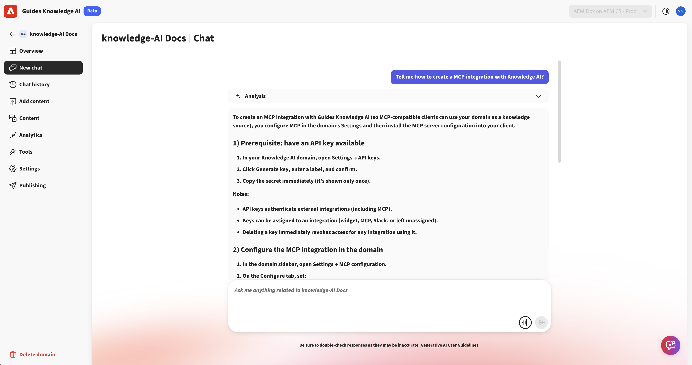

# 将Adobe Experience Manager Guides与Guides知识人工智能连接(Beta)

>[!IMPORTANT]
>
> 默认情况下，此功能处于禁用状态。 要启用“指南”知识人工智能功能，请联系您的客户成功团队。

本文为管理员和内容工程师提供了在知识人工智能中配置Guides知识人工智能访问权限并上传Experience Manager Guides内容以供使用的端到端流程。

## 流程概述

| 步骤 | 您将要做什么 |
|---|---|
| 1 | 在Adobe Developer Console中创建服务帐户，并根据您的环境配置该服务帐户。 |
| 2 | 从服务帐户凭据文件中检索技术帐户电子邮件。 |
| 3 | 通过创建角色并添加用户，在知识人工智能中授予服务帐户访问权限。 |
| 4 | 在Experience Manager Guides中配置知识人工智能输出预设并上传内容。 |


## 先决条件

在开始之前，请确保您具有以下访问和权限：

| 要求 | 用途 |
|---|---|
| Adobe Developer Console | 创建服务帐户并下载其JSON凭据。 |
| Adobe Experience Manager Guides | 创作内容并配置知识人工智能的输出预设。 |
| [知识人工智能](https://guidesai.adobe.io/) | 管理角色和用户，并接收上传的内容。 |
| 权限：创建服务帐户 | 在Adobe Developer Console中需要创建服务帐户。 |
| 权限：在知识人工智能中管理用户和角色 | 需要在知识人工智能中授予服务帐户访问权限。 |

## 创建服务帐户

知识人工智能使用服务帐户进行安全身份验证并访问内容。

1. 按照[配置微服务IMT配置](https://experienceleague.adobe.com/zh-hans/docs/experience-manager-guides/using/knowledge-base/kb-articles/publishing/configure-microservices-imt-config)中的说明操作

1. 创建新的服务帐户并下载生成的JSON凭据文件。

1. 使用下载的凭据配置所需的环境设置。

完成后，服务帐户应成功与您的环境关联。

>[!NOTE]
>
> 如果您已经为您的环境创建并配置了服务帐户，则可以继续下一步骤。


## 检索技术帐户电子邮件

要授予对知识人工智能的访问权限，请确定服务帐户。

1. 打开下载的服务帐户JSON文件。
1. 搜索字段名称`technical_account_email`。 查看类似于以下内容的值：

   ```json
   {
   "technical_account_email": "a1b2c3d4e5f6@techacct.adobe.com"
   }
   ```

1. 复制与`technical_account_email`关联的电子邮件地址。 您将在下一步中使用此电子邮件地址。

## 在知识人工智能中授予访问权限

要允许服务帐户管理和上传内容，请将其添加到具有适当权限的知识人工智能。

1. 打开[知识人工智能](https://guidesai.adobe.io/)。
1. 导航到&#x200B;**安全>角色**，创建具有最低所需权限的角色。
1. 导航到&#x200B;**安全>用户>添加用户**。 使用从服务帐户JSON复制的`technical_account_email`添加新用户，从&#x200B;**域**&#x200B;下拉列表中选择域，并分配在上一步中创建的角色。

服务帐户现在有权执行内容管理和上传操作。

## 配置知识人工智能预设并上传内容

要将内容发布到知识人工智能，请在设置权限后配置Experience Manager Guides。

1. 在Experience Manager Guides中打开&#x200B;**映射控制台**。
1. 导航到&#x200B;**输出预设**&#x200B;选项卡。
1. 选择+图标以创建输出预设。
1. 从&#x200B;**新建输出预设**&#x200B;对话框的&#x200B;**类型**&#x200B;下拉列表中选择&#x200B;**知识人工智能**。 输入&#x200B;**名称**&#x200B;并选择&#x200B;**添加到当前文件夹配置文件**&#x200B;以在当前文件夹配置文件中创建输出预设。

   

1. 选择&#x200B;**添加**。 即会创建知识人工智能预设。
1. 打开配置的知识人工智能预设。
1. 选择角色被授予`technical_account_email`的域，然后选择&#x200B;**上载内容**。 这会触发将内容上传工作流到知识人工智能。 等待上传过程完成。

   

1. 上载完成后，选择&#x200B;**在知识人工智能中打开**。 这将使用上传的内容在域中打开知识人工智能聊天。

   

您已成功配置服务帐户，分配了所需的权限，并在知识人工智能中提供了Experience Manager Guides内容。 无论何时要发布更新的内容，请创建新的知识人工智能预设，然后执行上面[配置知识人工智能预设并上传内容](#configure-knowledge-ai-preset-and-upload-content)部分中概述的步骤。


