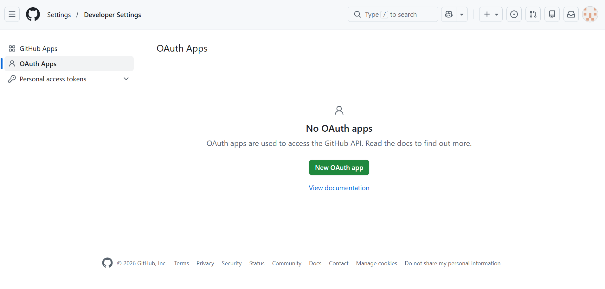
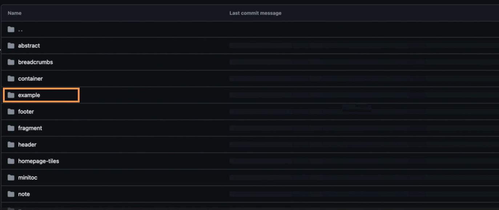

# Experience Manager Guides和Edge Delivery Services

Adobe Experience Manager Guides允许您通过基于GitHub的专用发布配置文件直接将DITA内容发布到Edge Delivery Services (EDS)。 此功能使组织能够提供高性能、响应式文档体验，同时在Experience Manager Guides中维护基于DITA的创作工作流。

有关在Adobe Experience Manager中使用EDS的详细信息，请查看[Edge Delivery Services概述](https://experienceleague.adobe.com/zh-hans/docs/experience-manager-cloud-service/content/edge-delivery/overview)。

要支持从Experience Manager Guides发布到EDS，您必须完成GitHub和Experience Manager Guides中的一系列配置步骤。 以下各节将依次概述每个步骤，并解释它们如何在整个发布工作流程中协同工作。

1. [为EDS设置和配置GitHub](#set-up-and-configure-github-for-eds)
2. [在Experience Manager Guides中创建并配置EDS的发布配置文件](#create-and-configure-a-publish-profile-for-eds-in-experience-manager)
3. [使用EDS块自定义输出](#customize-output-using-eds-blocks)

若要快速视频演练，请查看AEM Guides中的[发布](https://experienceleague.adobe.com/en/docs/experience-manager-guides/using/knowledge-base/expert-session/publishing-in-aem-guides-aug25)。


## 为EDS设置和配置GitHub

本节介绍如何设置和配置GitHub以与EDS一起使用。 它介绍如何使用Adobe样板创建存储库，通过AEM代码同步将GitHub连接到Adobe Experience Manager，配置所需的GitHub和OAuth应用程序，以及定义用于发布内容的存储库装入点。

### 为EDS创建GitHub存储库

EDS需要一个具有预定义结构的GitHub存储库。 Adobe提供了专为Experience Manager Guides用户设计的官方模板存储库。

执行以下步骤可创建存储库：

1. 打开Experience Manager Guides样板模板存储库[aem-guides-boilerplate](https://github.com/adobe/aem-guides-boilerplate)。
   

2. 使用此模板创建新存储库。 了解[从模板创建存储库](https://docs.github.com/en/repositories/creating-and-managing-repositories/creating-a-repository-from-a-template)。 确保将存储库可见性设置为&#x200B;*Public*，以便EDS可以访问该存储库。

   

存储库现已创建并与样板模板结构保持一致。


### 创建新的OAuth应用程序

在Experience Manager Guides中创建EDS发布配置文件时，需要使用OAuth应用程序对用户进行身份验证。 它使用&#x200B;*客户端ID*&#x200B;和&#x200B;*客户端密钥*&#x200B;启用安全登录流程。

执行以下步骤可创建新的OAuth应用程序：

1. 在GitHub上，导航到左侧边栏并选择&#x200B;**开发人员设置**。
2. 在左侧边栏中，选择&#x200B;**OAuth应用程序**。
3. 选择&#x200B;**新建OAuth应用程序**。

   {width="650"}

4. 通过提供以下强制性详细信息注册您的应用程序：

   - **应用程序名称**：输入EDS存储库的名称
   - **主页URL**：输入Experience Manager Guides实例的URL。 （有关示例URL格式，请参阅[创建新的GitHub应用程序](#create-a-new-github-app)部分的步骤4）。
   - **授权回调URL**：与主页URL相同

5. 选择&#x200B;**启用设备流**&#x200B;选项，然后选择&#x200B;**注册应用程序**&#x200B;以完成注册。

   {width="650"}

您的应用程序现已准备就绪。 记下&#x200B;*客户端ID*。 在Experience Manager Guides中配置发布配置文件时，您现在或以后最多可以生成五个&#x200B;*客户端密钥*。


### 在EDS存储库中配置装载点URL

EDS从存储库根目录的`fstab.yaml`文件中定义的&#x200B;*装入点* URL中读取内容。 此URL将EDS指向Experience Manager Guides发布所生成内容的位置。

要在`fstab.yaml`文件中配置挂载点URL，请执行以下操作：

1. 在GitHub存储库中，打开`fstab.yaml`文件。
2. 使用以下格式更新`url`值：

   ```text
   https://guides.adobe.com/eds-workers/<account type>/<git acc domain>/<git username>/<git repo>/<branch>/<root folder>
   ```

   下表介绍了URL中的每个字段：

   | 字段 | 描述 |
   |---|---|
   | `https://guides.adobe.com/eds-workers` | Experience Manager Guides用于向EDS发布内容的工作者URL。 请勿更改此值。 |
   | `<account type>` | Git帐户的类型。 设置为`github`。 |
   | `<git acc domain>` | Git帐户的域。 设置为`github.com`。 |
   | `<git username>` | 您的GitHub用户名。 |
   | `<git repo>` | 您为EDS创建的GitHub存储库的名称。 |
   | `<branch>` | 要发布内容的分支。 默认值为 `main`。 如果您在GitHub上更改分支名称，请在此处并在Experience Manager Guides的EDS发布配置文件中更新它。 |
   | `<root folder>` | 提交已发布文件的存储库的根文件夹。 默认值为 `docs`。 如果您在GitHub上更改文件夹名称，请在此处并在Experience Manager Guides的EDS发布配置文件中更新它。 |

   例如，如果您的GitHub用户名是`my-username`，存储库名称为`my-eds-repo`，则`fstab.yaml`文件将显示如下：

   ```yaml
   mountpoints:
     /:
       url: https://guides.adobe.com/eds-workers/github/github.com/my-username/my-eds-repo/main/docs
       type: markup
   ```

   {width="650"}

   >[!NOTE]
   >
   > 如果您继续使用以前的URL格式(`https://guides.adobe.com/eds-workers/<git username>/<git repo>/<branch>/<root folder>`)，则帐户类型和域默认为`github`和`github.com`。

3. 重复步骤2和3，从[通过AEM代码同步](#connect-github-to-adobe-via-aem-code-sync)部分将GitHub连接到Adobe以授权存储库。

### 通过AEM代码同步将GitHub连接到Adobe

Adobe Experience Manager使用名为&#x200B;**AEM Code Sync**&#x200B;的GitHub应用程序将内容从Experience Manager Guides推送到GitHub。

执行以下步骤以安装和配置&#x200B;*AEM代码同步*&#x200B;应用程序：

1. 导航到[AEM代码同步](https://github.com/apps/aem-code-sync)页面，然后选择&#x200B;**安装**。

   **AEM代码同步**&#x200B;监视存储库更改并确保将更新正确推送到GitHub。

   >[!NOTE]
   >
   >安装应用程序时，请确保您使用的是拥有存储库的同一GitHub帐户。

   

2. 在下一页上，授予对您创建的存储库的访问权限。 选择&#x200B;**仅选择存储库**，然后从下拉列表中选择您的存储库。

   {width="350"}

3. 选择&#x200B;**安装并授权**。

   您将被重定向到GitHub设置页面。

   

4. 查看源代码详细信息并选择&#x200B;**下一步**。

5. 在&#x200B;**内容源**&#x200B;页面上，配置以下设置：

   - **内容源类型：**&#x200B;选择&#x200B;**其他（自带标记）**。
   - **内容源URL：**&#x200B;查看`fstab.yaml`文件中配置为装入点URL的URL。 如果您尚未更新文件中的URL，可以在此处更新它。
   - **文件扩展名：**&#x200B;将默认`.html`后缀更改为`.htm`。

   确保已选择&#x200B;**使用其他内容源**。

6. 在&#x200B;**用户**&#x200B;页面上，根据需要添加用户，然后选择&#x200B;**下一步**。

7. 查看配置摘要并选择&#x200B;**保存**。

   成功注册后，将显示确认页面。 您可以从此页面复制并保存您网站的&#x200B;**预览**&#x200B;和&#x200B;**实时** URL。

   

## 为EDS设置和配置GitLab

有关将GitLab配置为Edge Delivery Services的发布存储库的说明，请查看[为EDS设置和配置GitLab](./configure-eds-gitlab.md)。

## 在Experience Manager中创建并配置EDS的发布配置文件

以下各节将依次概述每个步骤，并解释如何在Experience Manager Guides中设置EDS发布配置文件、配置输出预设以及使用EDS生成输出。

### 创建GitHub或GitLab的EDS发布配置文件

1. 转到&#x200B;**[Workspace设置](/help/product-guide/cs-install-guide/workspace-settings.md)** **>** **发布配置文件**。
2. 选择&#x200B;**+**&#x200B;图标以创建新的发布配置文件并提供以下详细信息：

   - **服务器类型\*：**&#x200B;从下拉列表中选择&#x200B;**Git （Edge Delivery服务）**。
   - **名称\*：**&#x200B;输入发布配置文件的名称。
   - **Git帐户类型\*：**&#x200B;从下拉列表中选择&#x200B;**GitHub**&#x200B;或&#x200B;**GitLab**，具体取决于您的Git存储库提供程序。
   - **实例URL\*：**&#x200B;输入GitHub或GitLab实例的URL，例如`https://github.com`或`https://gitlab.com`。
   - **存储库名称\*：**&#x200B;输入GitHub或GitLab存储库的名称。
   - **用户名\*：**&#x200B;输入您的GitHub或GitLab用户名。
   - **分支名称：**&#x200B;设置为`main`（默认）。
   - **根文件夹\*：**&#x200B;设置为`docs`（默认）。
   - **站点所有者（仅&#x200B;*GitLab*）：**&#x200B;输入Edge Delivery Services站点的所有者。
   - **站点存储库（仅&#x200B;*GitLab*）：**&#x200B;输入与Edge Delivery Services站点关联的存储库名称。
   - **HLX API密钥：**&#x200B;输入用于EDS配置的HLX API密钥。 要支持Experience Manager Guides as a Cloud Service 2026.11.0版本中引入的未发布功能，需要此密钥。 此外，如果内容大小超过100个文件，则需要密钥才能将内容发布到EDS。
   - **身份验证凭据：**&#x200B;提供基于所选Git帐户类型的凭据：
     - **GitHub：**&#x200B;输入从您的GitHub OAuth应用程序获得的&#x200B;**客户端ID\***和&#x200B;**客户端密钥\***。 有关详细信息，请参阅[创建新的OAuth应用程序](#create-a-new-oauth-app)。
     - **GitLab：**&#x200B;输入为您的GitLab帐户生成的&#x200B;**Access token\***。
3. （*仅限GitHub*）选择&#x200B;**登录**&#x200B;以进行身份验证。 对于GitLab，无需登录，因为访问令牌将用于身份验证。

   {width="650"}

4. 选择&#x200B;**保存**。 对于GitHub，在成功进行身份验证后，**保存**&#x200B;选项可用。

您的EDS发布配置文件现已配置完成。

### 创建EDS的输出预设并生成输出

1. 在地图控制台中打开您的地图。
2. 在&#x200B;**输出预设**&#x200B;选项卡中，选择&#x200B;**+**&#x200B;以创建新的输出预设。
3. 在&#x200B;**新建输出预设**&#x200B;对话框中，提供以下详细信息：
   - **类型**：选择&#x200B;**Edge Delivery服务**
   - **名称**：提供此预设的名称
4. 选择&#x200B;**添加**。

   {width="650"}
5. 打开新创建的EDS输出预设，并配置以下字段：

   - **条件筛选：**&#x200B;选择&#x200B;**无**&#x200B;生成输出而不进行筛选，或选择&#x200B;**使用DITAVAL**&#x200B;应用条件筛选。
   - **发布子文件夹：**&#x200B;输入在其中发布输出的子文件夹的名称。 子文件夹在存储库的根文件夹下创建，其名称显示在指向已发布内容的EDS链接中。 例如，如果根文件夹为`docs`，而发布子文件夹为`product-guide`，则内容将发布到`docs/contents/product-guide`。
   - **发布配置文件：**&#x200B;选择在上一部分中配置的GitHub或GitLab发布配置文件。

     {width="650"}

6. 选择&#x200B;**保存**，然后选择&#x200B;**生成输出**。

>[!NOTE]
>
>生成的输出存储在EDS存储库的`<root folder>/contents/<publish subfolder>`文件夹中。

此时会生成EDS输出。 内容以简洁的响应布局显示。 它包括常规元素，例如页面标题、痕迹导航、正文内容以及主题中使用的任何块。 左侧的目录（从地图生成）可帮助您跨主题导航，而右侧的迷你目录会突出显示当前页面中的部分。 整个输出完全响应，确保跨设备优化、一致的读取体验。

>[!NOTE]
>
> 您可以将多个DITA映射发布到同一网站。 发布的映射将显示在左侧导航面板中，允许用户从每个映射访问内容。 发布新映射不会覆盖以前发布的映射。


## 使用EDS块自定义输出

EDS使用`blocks`来控制内容的不同部分的样式和显示方式。 您可以修改现有块或创建自定义块。

以下列出的示例指导您完成自定义现有块并创建新块以设置Experience Manager Guides中最终EDS输出的样式。

### 自定义痕迹导航块以更新其文本颜色

跨页面使用痕迹导航，以帮助用户了解它们在文档中的位置。 由于此块在整个网站中始终显示，因此更新其样式可以统一更新设计。

执行以下步骤可自定义痕迹导航块以更新其文本颜色：

1. 转到您的GitHub存储库并打开`blocks`文件夹。
2. 选择&#x200B;**痕迹导航**&#x200B;块。

   {width="650"}
3. 打开`css`文件并更新文本颜色。
4. 将更改提交到GitHub。
5. 刷新实时网站以查看更新。

### 更新EDS脚本以在发布的输出中创建自定义元素

在某些情况下，您可能希望仅设置内容特定部分的样式。 请使用自定义块执行以下步骤来实现这一点。

1. 打开主题文件并选择标记元素中的文本。

   在以下屏幕截图中，选择了`example`标记中的内容。
   {width="650"}
2. 要配置`example`标记中的文本，请执行以下操作：
   - 导航到&#x200B;**内容属性**。
   - 添加`outputclass`属性。
   - 将其值设置为`example eds-force-block`。
   - 选择&#x200B;**添加**。
     {width="650"}
3. 保存并重新生成输出。
4. 在`blocks`目录中创建一个与`outputclass`同名的新文件夹。 了解[将文件添加到存储库](https://docs.github.com/en/repositories/working-with-files/managing-files/adding-a-file-to-a-repository#adding-a-file-to-a-repository-using-the-command-line)。

   {width="650"}

5. 添加必需的`css`和可选的`js`文件。

   {width="650"}

6. 提交更改并重新生成输出。

所选内容现在显示块中定义的自定义样式。

{width="650"}
