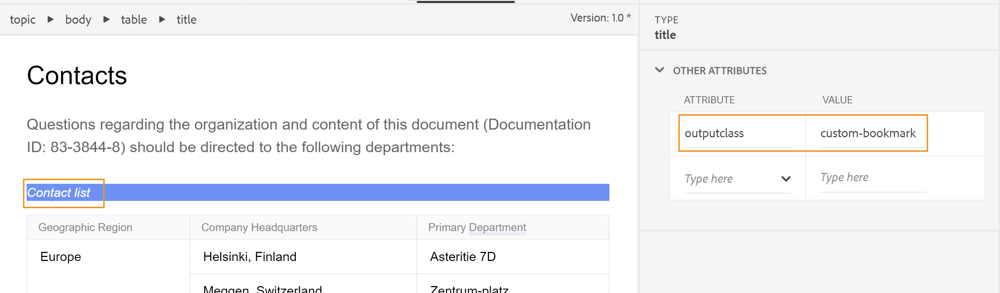
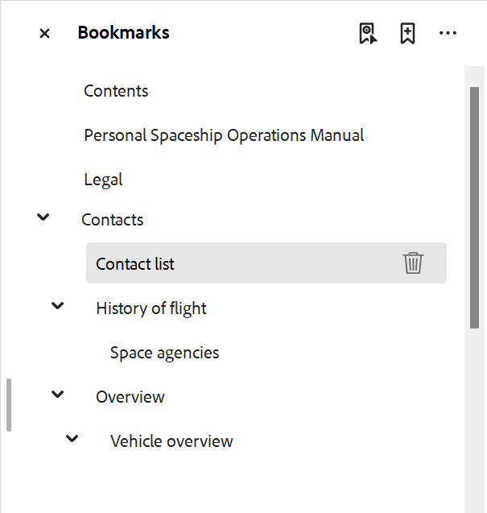

# 在PDF输出中添加自定义书签

通常，DITA映射中的目录将作为书签复制到最终PDF输出中，包括选择时打开目录页面的&#x200B;**目录**&#x200B;标题。 此TOC是根据DITA映射中的主题或节标题创建的。

有时，您可能希望在PDF输出中为特定内容添加自定义书签以方便导航。 可以通过在元素上添加`outputclass`属性并将以下属性应用于该元素来做到这一点：

`bookmark-level: 3`

在此，`bookmark-level`是一个属性，数字`3`是指示书签层次结构中添加书签的级别的值。 在以下示例中，第一级主题“联系人”有一个表“联系人列表”，我们在该表中添加了一个值为`custom-bookmark`的`outputclass`属性。




`custom-bookmark`类的以下定义已添加到CSS文件中：

```css
…
/*Adding a custom bookmark*/
.custom-bookmark{
    bookmark-level: 2
}
…
```

在PDF输出中，*联系人列表*&#x200B;表被添加在PDF书签列表的第2级，如下所示：

 {width="300"}

>[!NOTE]
>
>您必须选择添加自定义书签的正确级别。 如果指定的数字小于父级主题的书签，则自定义书签将占据父级书签的位置，而所有其他书签将显示为子级。 这可能会导致出现意外的书签结构。

**从PDF输出书签中删除“目录”标题**

如果您不想在PDF输出中包含&#x200B;**Contents**&#x200B;标题，可以通过将&#x200B;**Contents**&#x200B;放置在`<p>`元素中而非`<h1>`元素中来删除该标题。

从书签中删除“内容”标题的分步过程如下所示：

1. 打开用于PDF输出的PDF模板。
2. 打开&#x200B;**页面布局**&#x200B;中的&#x200B;**目录页面**。
目录页面显示在右侧。
3. 切换到&#x200B;**Source**&#x200B;模式并将内容所在的元素从`<h1>`更改为`<p>`。

更改前：

```
<h1 class="toc-title">Contents</h1>
```

更改后：

```
<p class="toc-title">Contents</p>
```

保存更改并重新生成输出。


