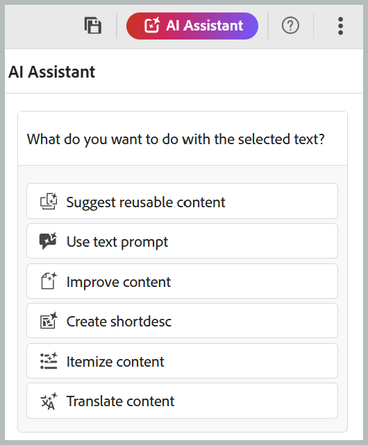

# AI 助手

>[!NOTE]
>
> AI助手功能当前适用于Adobe Experience Manager Guides as a Cloud Service。

Adobe Experience Manager Guides中的AI Assistant是一款AI支持的工具，旨在通过简化内容创建、管理和创作工作流来提高工作效率。 它提供两种模式：Agentic和Standard。 在&#x200B;**代理模式**&#x200B;中，AI Assistant允许您通过自然语言交互执行与内容相关的任务，并具有“导入”、“创建”和“智能标记”等技能以简化内容创建、组织和元数据管理。 在&#x200B;**标准模式**&#x200B;中，AI Assistant提供创作帮助，帮助您更高效地创建、优化和管理内容。

## AI助手模式

AI助手有两种模式可用：**代理**&#x200B;和&#x200B;**标准**。 管理员可以从&#x200B;**Workspace设置**&#x200B;中&#x200B;**常规**&#x200B;选项卡的&#x200B;**AI功能**&#x200B;部分中选择模式。 编辑器中的AI助手面板在这两种模式下都保持不变，但可用功能有所不同：

- **代理模式：**&#x200B;使用&#x200B;**导入**、**创建**&#x200B;和&#x200B;**智能标记**&#x200B;的技能将文件转换为结构化主题、创建内容的第一个草稿，并根据您组织的分类推荐相关标记。
- **标准模式：**&#x200B;通过上下文操作（如内容重用、翻译和内容质量改进）提供AI支持的创作帮助，以简化创作工作流。

## 代理模式

>[!NOTE]
>
> 要在代理模式下使用AI助手，您的组织需要登记到Adobe CX Enterprise Coworker并具有可用积分；登记后，请联系您的客户成功团队以启用该功能。 有关配置详细信息，请查看[在代理模式下配置AI助手](../install-conf-guide/configure-ai-assistant-agentic-mode-cs.md)。

AI Assistant中的代理模式允许您通过自然语言交互执行各种与内容相关的任务，例如创建和导入内容、总结主题、将主题添加到地图和管理元数据。 您可以在聊天面板中描述您的要求，AI Assistant规划和执行任务，同时提供任务的进度。 通过代理模式可快速访问以下技能：

- **导入**：将PDF、Word或Markdown文件从设备或内容存储库转换为结构化主题。 有关详细信息，请使用AI助手查看[导入内容](./import-ai-assistant.md)。

- **创建**：从输入材料（如规格、白板图像、屏幕快照和其他参考内容）生成草稿主题和地图，并可以选择将现有内容用于色调和样式。 有关详细信息，请查看[使用AI助手创建内容](./create-ai-assistant.md)。

- **智能标记**：建议根据组织分类的主题使用相关标记，以提高元数据一致性。 有关更多详细信息，请使用AI助手查看[智能标记](./ai-assistant-agentic.md)。

AI Assistant面板的以下组件可帮助您添加内容、输入提示和启动任务：

- **(A)**&#x200B;对话历史记录：查看并重新打开以前的对话，以查看以前的请求和响应。
- **(B)**&#x200B;全屏：将AI助手面板展开到全屏。
- **(C)**&#x200B;提示空间：输入提示请求，或键入`/`以添加文件并生成标记。
- **(D)**&#x200B;附加文件或添加上下文：从本地系统添加主题、映射或文件以提供AI助手处理的内容。
- **(E)**&#x200B;发送：将您的提示和附加内容提交到AI助手。
- **(F)**&#x200B;快速操作：直接从以下快捷方式之一启动任务： **导入**、**创建**&#x200B;或&#x200B;**标记**。

## 标准模式

标准模式可让您更智能、更快速地完成创作过程。 在编辑器中选择文本时，AI助手会提供快速操作，例如生成内容重用的智能建议、翻译内容、提高内容质量等，所有这些都基于您选择的内容。 这提高了作者的整体创作体验和生产力。

有关详细信息，请使用AI助手查看[创作文档](./ai-assistant-right-panel.md)。

## 开始使用 AI 助手

首次使用&#x200B;**AI助手**&#x200B;时，系统会提示您先提交同意，然后再使用Experience Manager Guides创作AI功能。

执行以下步骤以启动AI助手：

1. 登录到Experience Manager Guides。
1. 在主页上，从顶部选择&#x200B;**AI助手**。 确保管理员已在所需模式下启用AI助手功能。
AI助手显示关键功能、用户指南链接和**开始使用**&#x200B;按钮。
1. 仔细阅读用户准则，然后选择&#x200B;**开始使用**&#x200B;以启动AI助手。

>[!NOTE]
>
>如果您已同意使用帮助助手功能的准则，则系统将不再提示您同意使用帮助助手功能，您可以继续使用AI助手功能。

**相关主题**

[AI Assistant安全常见问题解答](./ai-assistant-faq.md)

[Adobe Experience Manager Guides Generative AI披露](./adobe-generative-ai-disclosures.md)

[配置AI助手以进行智能帮助和创作](../cs-install-guide/conf-smart-suggestions.md)
