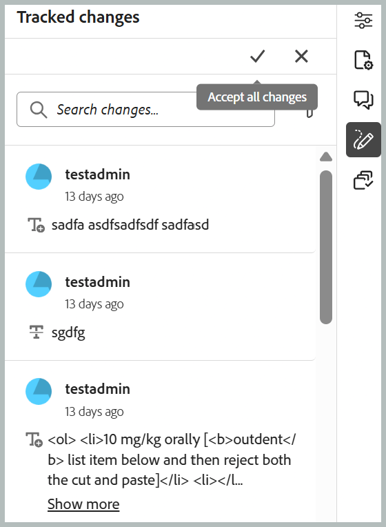
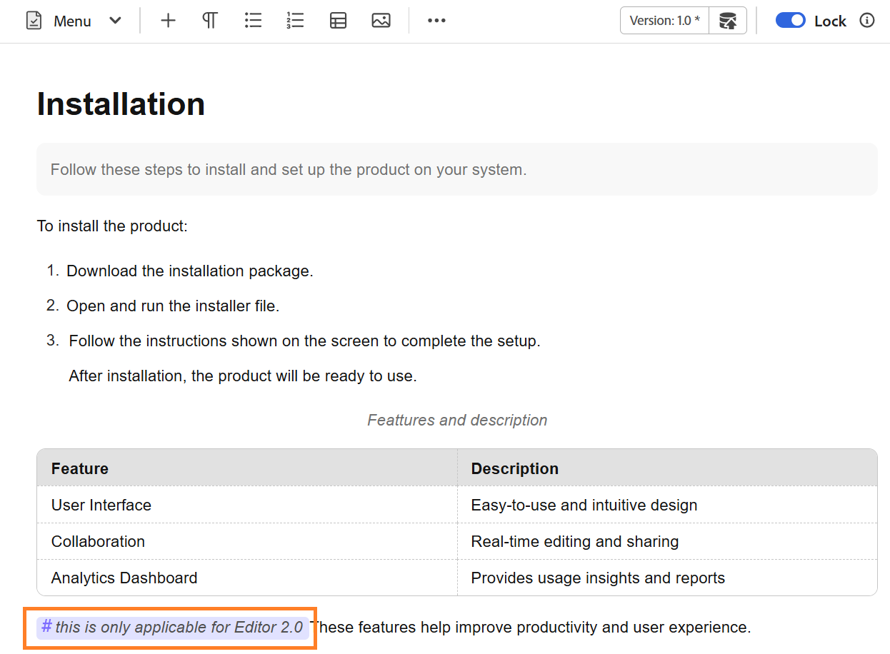
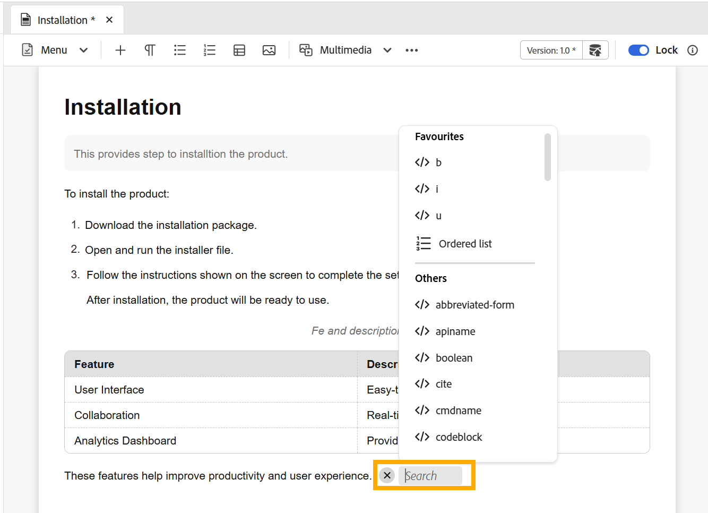

# 编辑器设置

>[!NOTE]
>
> 本文仅适用于新编辑器。 要在您的环境中启用此功能，请联系AEM Guides客户成功团队。

编辑器设置提供了一个集中的配置面板，允许您在单个作者级别自定义编辑器行为。 它在创作过程中提供了更大的灵活性、一致性和控制能力。

通过这个集中式设置面板，您可以从单个位置管理关键编辑器首选项，从而减少对分散或手动配置的需求。 可以从选项卡栏上的&#x200B;**更多操作**&#x200B;访问编辑器设置。

{width="650"}

## 支持的配置选项

编辑器设置允许您根据自己的首选项自定义各种选项，包括跟踪更改、显示标记、快速插入菜单等。

{width="350"}

### 跟踪更改

>[!NOTE]
>
>- 此功能默认处于启用状态，若要禁用此功能，请联系AEM Guides客户成功团队。
>- 处理表时，会跟踪行或列的插入，但不会在“跟踪更改”面板中跟踪行或列的删除。

启用&#x200B;**跟踪更改**&#x200B;模式以记录对主题所做的编辑。 启用后，系统会在您工作时捕获每次插入和删除操作，所有更改都列在&#x200B;**跟踪更改**&#x200B;面板中。 在同一位置进行的连续编辑将被分组，并在&#x200B;**跟踪更改**&#x200B;面板中显示为单个更改。

删除的内容以删除线显示，而插入的内容以绿色文本显示。 此外，更改条沿主题页面的边缘显示，红色条表示已删除的内容，绿色条表示添加的内容。 如果某行同时包含添加和删除内容，则将显示两个更改条。

当多个用户处理同一主题时，利用跟踪更改可以查看彼此的编辑。 内容准备好最终确定后，用户可以查看跟踪的更改并接受或拒绝它们。

{width="350"}

**显示内嵌的跟踪删除**

控制打开跟踪更改时在编辑器中显示已删除内容的方式。 启用后，已删除的内容将保持其原始位置的内联可见状态，作为删除线文本。 禁用后，不会显示已删除的内容。 取而代之的是，删除内容的位置会显示一个铅笔图标，以便您更简洁地查看主题。 选择铅笔图标以转到跟踪的更改面板中对应的已删除内容。

{width="350"}

**接受或拒绝跟踪的更改**

要查看更改，请选择右侧面板中的&#x200B;**跟踪更改**&#x200B;图标以打开跟踪的更改面板，然后执行以下步骤：

1. 在面板中选择一个跟踪的更改。 在文档中选择更改的内容。
1. 选择&#x200B;**接受更改**&#x200B;图标以接受更改，或选择&#x200B;**拒绝更改**&#x200B;图标以拒绝更改。

   {width="650"}

1. 若要通过单击接受或拒绝所有更改，请从面板顶部选择&#x200B;**接受所有更改**&#x200B;或&#x200B;**拒绝所有更改**。

   {width="650"}

### 不间断空格

启用此选项以在编辑器中编辑无中断空格时显示指示符。 它仅在DITA主题和DITA映射的“创作”视图中可见。

### XML注释

使作者能够在创作模式下直接查看、编辑和插入XML注释，以便在内容中更好地显示。 启用后，作者可以在创作模式本身的内容中直接查看、插入、编辑和删除XML注释，从而更轻松地为协作者添加上下文注释。 在禁用时，XML注释在“创作”模式下隐藏，并且无法从“创作”模式插入或修改，从而确保为不需要注释的用户提供更简洁的创作体验。 您可以继续使用`<!-- test comment -->`语法在源模式下查看和创作XML注释。

>[!NOTE]
>
> 对于XML注释，**跟踪更改**&#x200B;只记录整个注释的插入或删除。 在现有XML注释中所做的编辑不会被记录。

{width="650"}

### 标记

控制标记在编辑器中的可见性。 启用后，结构标记将显示在内容中，允许作者查看和管理底层DITA结构。 禁用后，这些标记会被隐藏，以提供更清晰、更集中的创作体验。

{width="650"}

启用&#x200B;**显示标记**&#x200B;设置时，您还可以启用&#x200B;**显示属性**&#x200B;以查看和验证与元素关联的属性。 当元素具有三个以上的与其关联的属性时，将显示一个计数指示器。 将鼠标悬停在指示器上会显示应用于该元素的属性的完整列表。

    ！[配置带有属性的标记](./images/config-tags-attributes.png) {width=&quot;650&quot;}

### 编辑器中的快速插入菜单

允许在以创作模式编辑时，直接在光标位置添加元素，而无需导航到工具栏。 也可以在&#x200B;**收藏夹**&#x200B;中配置常用元素，以便更快地进行访问。 当您在Windows上按&#x200B;**Control + /**&#x200B;或在macOS上按光标位置上的&#x200B;**Command + /**&#x200B;时，可以在编辑器中直接使用快速插入菜单。

{width="650"}

您可以搜索元素并将其添加到收藏夹，删除任何以前添加的元素，并使用简单的拖放操作重新排列它们。 收藏夹包含您最常用的元素，从编辑器访问时，您在此处设置的顺序会反映在“快速插入”菜单中。

以下是一段关于如何使用新编辑器中的快速插入菜单的简短视频。

>[!VIDEO](https://video.tv.adobe.com/v/3491343)

