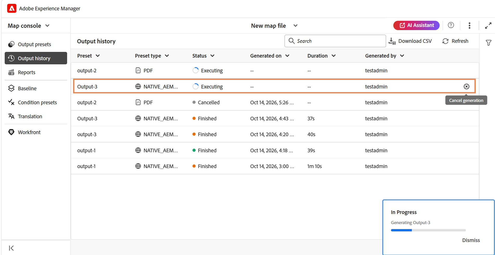
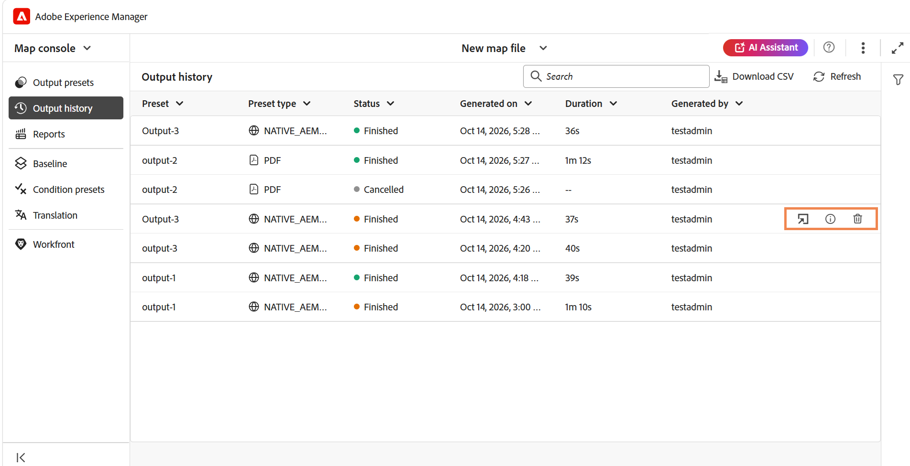
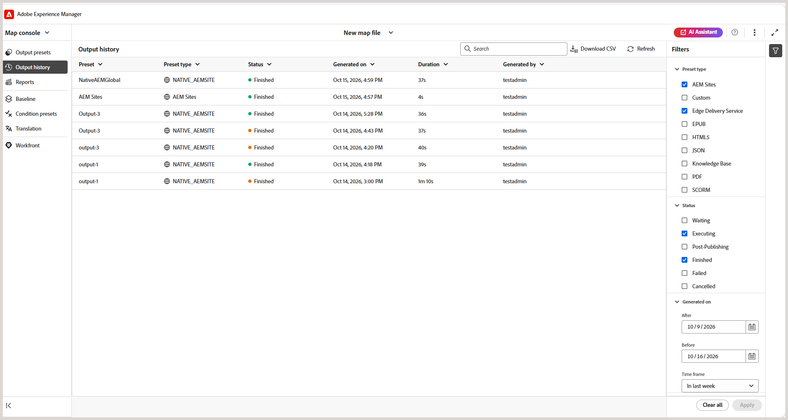
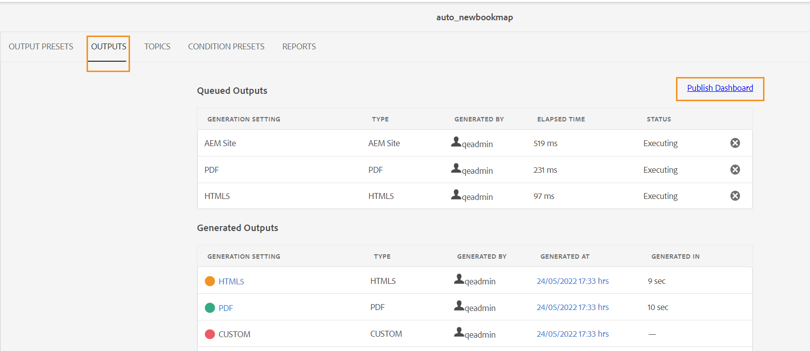
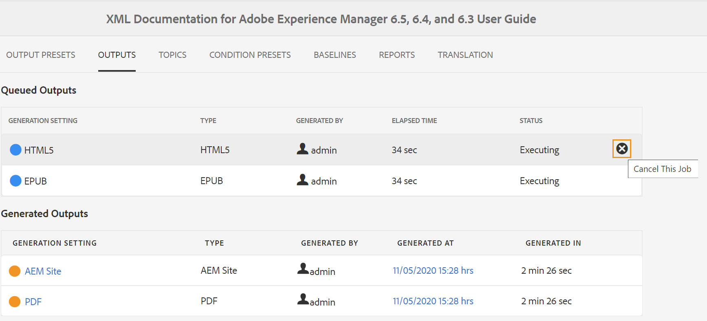
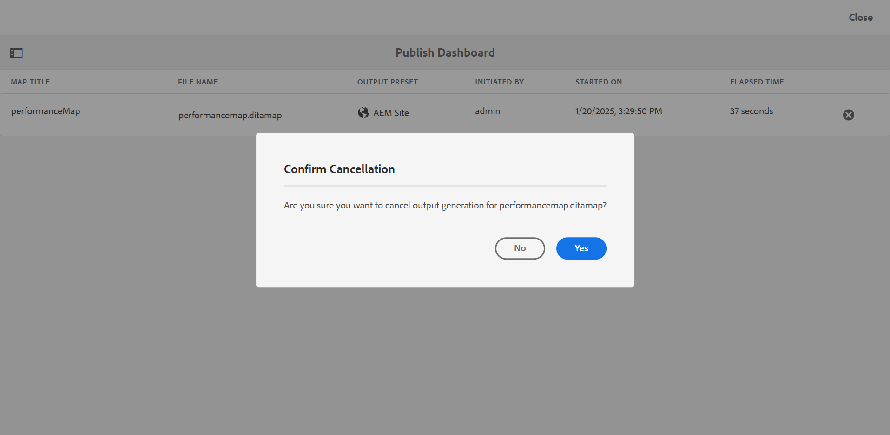
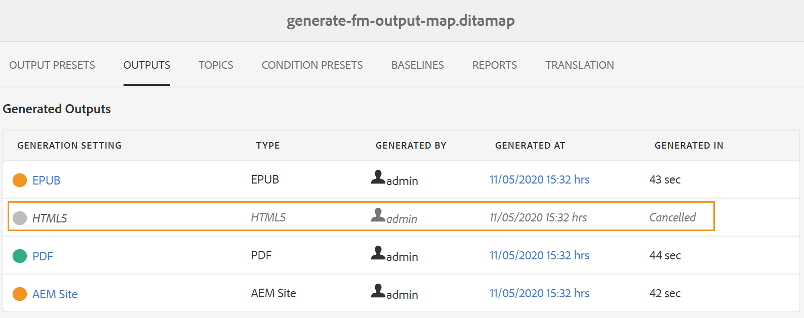
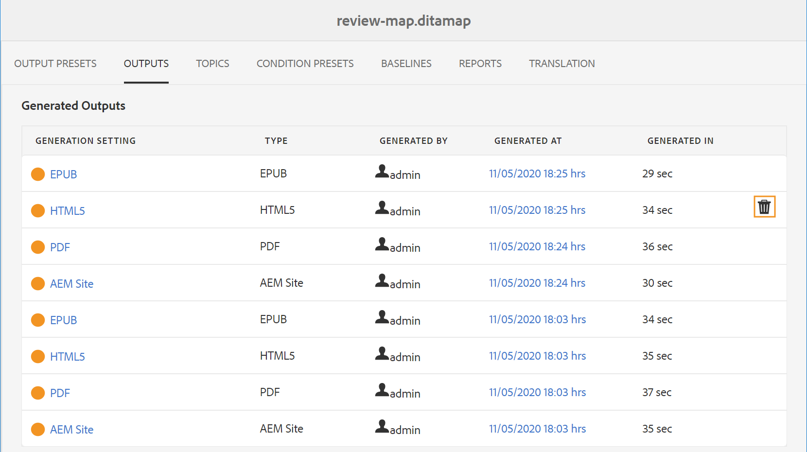

# 管理输出生成流程

Adobe Experience Manager Guides允许您监视和管理DITA映射的输出生成任务。 您可以查看输出生成任务的状态、取消正在进行的任务以及从输出生成历史记录中删除过时的条目。

为映射启动输出生成任务或重新生成选定主题后，Experience Manager Guides会将该任务发送到输出生成队列。 随着输出生成过程的进行，任务的状态会更新。

您可以使用编辑器中的&#x200B;**输出历史记录**&#x200B;选项卡或Assets UI中的&#x200B;**输出**&#x200B;选项卡查看和管理输出生成任务。

## 从编辑器中查看和管理输出生成任务

可以直接从“映射”控制台的&#x200B;**输出历史记录**&#x200B;选项卡查看和管理输出生成任务。

在“映射”控制台中打开DITA映射，然后使用Experience Manager Guides中可用的任何输出预设生成输出。 切换到&#x200B;**输出历史记录**&#x200B;选项卡以查看输出生成任务的状态和其他详细信息，如下所示：

对于每个输出生成任务，可以查看以下信息：

1. **预设：**&#x200B;用于生成输出的输出预设的名称。
1. **预设类型：**&#x200B;用于生成输出的输出预设类型。
1. **状态：**&#x200B;输出生成任务的当前状态，如“等待”、“正在执行”、“已完成”、“失败”、“发布后”或“已取消”。
1. **生成日期：**&#x200B;生成输出的日期和时间。
1. **持续时间：**&#x200B;生成输出所用的时间。
1. **生成者：**&#x200B;启动输出生成任务的用户的名称。

>[!NOTE]
>
> 如果输出生成任务当前正在进行中，则&#x200B;**状态**&#x200B;列中的&#x200B;**正在执行**&#x200B;标签表示正在处理该任务。 使用&#x200B;**刷新**&#x200B;查看输出生成任务的最新状态。

您还可以取消正在进行的输出生成任务。 若要取消正在进行的任务，请将鼠标悬停在任务行上，然后选择&#x200B;**取消生成**。

任务取消后，**Canceled**&#x200B;标签将显示在&#x200B;**Status**&#x200B;列中。

对于已完成的输出生成任务，将鼠标悬停在任务行上以访问以下操作，具体取决于任务状态：

- **打开输出：**&#x200B;在新选项卡中查看生成的输出。
- **查看日志：**&#x200B;访问输出生成日志以查看发布详细信息并排除错误或警告。
- **删除输出历史记录：**&#x200B;从输出生成历史记录中删除所选任务，但不删除生成的输出。

您还可以使用以下选项来处理输出生成历史记录：

- **搜索：**&#x200B;使用搜索字段在历史记录中查找特定的输出生成任务。
- **下载CSV：**&#x200B;选择&#x200B;**下载CSV**&#x200B;以CSV格式下载输出生成历史记录。
- **调整列大小：**&#x200B;选择列名旁边的下拉菜单，然后选择&#x200B;**调整列大小**&#x200B;以调整列宽。
- **筛选器**：根据输出预设类型、任务状态以及日期和时间范围应用筛选器以缩小输出生成历史记录。

  

此外，颜色编码的图标可指示每个任务的状态：绿色表示成功的任务，橙色表示已完成但有消息的任务，红色表示失败的任务。 这有助于您快速识别需要注意的任务。

## 从Assets UI查看和管理输出生成任务

使用Assets AI，您可以对生成的输出执行以下操作：

- [查看输出生成任务的状态](#view-the-status-of-the-output-generation-task)
- [取消输出生成任务](#cancel-an-output-generation-task)
- [删除输出任务](#delete-an-output-task)

### 查看输出生成任务的状态

启动映射的输出生成任务或重新生成选定主题后，Experience Manager Guides会将此任务发送到输出生成队列。 此队列将实时更新，显示队列中每个输出生成任务的状态。

1. 在Assets UI中，导航到要检查输出生成状态的映射文件并将其打开。

1. 选择&#x200B;**输出**。

   

   “输出”页面分为两个部分：

   - **已排队的输出：**

     列出正在等待生成或正在生成过程中的输出。 已排队或正在进行的任务在预设名称之前会显示一个蓝色图标。 您还可以找到用于已排队任务的输出生成设置或预设、类型、启动任务的用户、自任务排队以来的时间以及当前状态。

     选择链接以访问&#x200B;**发布功能板**&#x200B;并查看当前运行状态。 发布功能板中提供了所有活动发布任务的列表。 仅当存在等待生成或正在生成过程中的输出时，才会显示&#x200B;**排队的输出**&#x200B;和&#x200B;**发布功能板**&#x200B;链接。 输出任务完成后，它们不会显示。有关发布仪表板的更多详细信息，请查看[使用发布仪表板](generate-output-publish-dashboard.md#)管理发布任务。

   - **生成的输出**

     列出已完成的输出任务。 同样，此处显示的信息与“已排队输出”部分类似，但有一些差异。 您有输出结果图标和输出生成时间形式的新信息集。

     在此列表中，您可能有已成功执行的任务、已使用消息执行的任务或失败的任务。 成功的任务以绿色图标显示，带有消息的任务以橙色图标显示，失败的任务以红色图标显示。

     对于所有任务，发布过程将创建一个日志文件\(logs.txt\)，可以通过在&#x200B;**Generated At**&#x200B;列中选择链接来访问该文件。 对于失败或包含消息的任务，您可以查看日志文件（在[查看一节中进行了说明），然后查看日志文件](generate-output-basic-troubleshooting.md#id1822G0P0CHS)。

     >[!NOTE]
     >
     > 选择生成的PDF输出的链接时，系统会要求您下载PDF。

### 取消输出生成任务

Experience Manager Guides为出版商提供了一种简单而轻松的方式来取消任何正在进行的发布任务。 作为发布者，您可以从DITA映射控制台或[发布仪表板](generate-output-publish-dashboard.md#)取消正在进行的发布任务。

执行以下步骤以从DITA映射控制台取消输出生成任务：

1. 在Assets UI中，导航到要取消正在进行的输出生成任务的映射文件并将其打开。

1. 选择&#x200B;**输出**。

1. 在&#x200B;**排队的输出**&#x200B;列表中，将指针悬停在要取消的任务上。

1. 选择&#x200B;**取消此作业**&#x200B;图标。

   

1. 在&#x200B;**确认取消**&#x200B;消息提示中选择&#x200B;**是**。

   

   如果任务尚未启动，则对任务执行cancel命令。 对于正在取消的任务，“状态”将设置为“正在取消”。

   成功取消任务后，该任务将移至&#x200B;**生成的输出**&#x200B;列表，状态为&#x200B;**已取消**。 当您将鼠标悬停在已取消的任务上时，它会显示已取消任务的用户的名称。 在以下屏幕截图中，*HTML5*&#x200B;任务已被取消。

   

### 删除输出任务

当您为DITA映射生成多个输出时，在一段时间内，此类映射的已生成输出列表会变得非常长。 作为发布者，您可以通过从&#x200B;*生成的输出*&#x200B;列表中删除过时的任务来清除任何映射文件的输出历史记录。 请注意，不会从系统中删除输出，只会从&#x200B;*生成的输出*&#x200B;列表中删除生成的输出条目。

执行以下步骤以从“已生成的输出”列表中删除输出任务：

1. 在Assets UI中，导航到要从中删除任务的映射文件并将其打开。

1. 选择&#x200B;**输出**。

1. 在&#x200B;**生成的输出**&#x200B;列表中，将指针悬停在要删除的任务上。

1. 选择删除图标。

   

1. 在&#x200B;**确认删除**&#x200B;消息提示中选择&#x200B;**是**。

   该任务将从“生成的输出”列表中删除。

