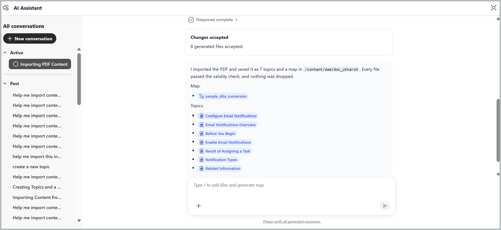

# 使用AI助手导入内容

AI Assistant代理模式中的&#x200B;**导入**&#x200B;技能可帮助您将现有PDF、Word或Markdown文件转换为结构化DITA主题，并可以选择根据用户输入生成DITA映射。 它通过减少重新创建、结构和整理内容所需的手动工作，简化了Adobe Experience Manager Guides中从非结构化格式到结构化格式的内容摄取。

## 导入文件

您可以从设备或内容存储库导入文件，指定定义新主题开始的标题级别，并为导入的内容选择目标文件夹。 要导入文件，请执行以下步骤：

1. 登录到Experience Manager Guides。
1. 在主页上，从导航栏中选择&#x200B;**AI助手**。 确保管理员已启用代理模式[&#128279;](../install-conf-guide/workspace-settings.md)中的AI助手。
1. 从AI助手面板中选择&#x200B;**导入**。 您还可以使用其他提示，如&#x200B;*将此Docx转换为DITA主题*（对于Word文件）或&#x200B;*将此Markdown转换为DITA主题*（对于Markdown文件）。

   提示框中会显示起始提示&#x200B;*帮助我从附加的PDF文件导入内容*。

1. 使用以下任一方法将文件附加到提示中：

   - **使用快捷方式**：在“提示”字段中键入`/`，然后选择&#x200B;**添加存储库引用**&#x200B;以从存储库中选择文件（或&#x200B;**从设备添加文件**&#x200B;以从计算机上载文件）。

   - **使用“附加文件”或“添加上下文”图标(+)**：从本地系统添加文件以提供导入内容。

   - **拖放**：将要从系统导入的文件直接拖放到提示空间。

     

1. 选择&#x200B;**发送**。

   AI Assistant会分析文件并列出它完成的每个步骤。

1. 选择并确认要保存导入主题的文件夹。

   

1. 选择成为主题的标题级别。 例如，H2，如屏幕快照中所示。

   回答任何其他似乎为导入过程提供必要详细信息的跟进问题。

   

1. 选择&#x200B;**确认**。

   AI Assistant开始转换文件。 “导入”技能可根据导入的内容自动标识和分配适当的DITA主题类型，如“任务”、“疑难解答”等。

1. 选择&#x200B;**预览**&#x200B;以查看生成的主题和映射。

   检查每个主题是否以您期望的标题开头，以及映射顺序是否与原始文件匹配。 您还可以检查使用Source选项卡导入的数据的Source代码。

   

1. 选择下列选项之一：

   - **接受**&#x200B;以保存所有主题和到您确认的文件夹的映射。
   - **拒绝**&#x200B;放弃导入而不保存任何内容。 您可以提供拒绝导入的原因，并输入提示以指定所需的更改。 AI助手使用您的反馈来修订导入。

   主题和地图现在可在存储库中使用。

   

转换完成后，AI Assistant会打开生成的主题和映射的预览。 您可以直接从AI助手对话框导航到相应的映射和主题。

## 将粘贴的内容作为主题导入

通过从网页、Word、Google Docs或Wiki粘贴内容，您可以导入内容而无需先保存文件。 带格式的内容保留其标题、列表和表格。

要导入粘贴的内容，请执行以下操作：

1. 登录到Experience Manager Guides。
1. 在主页上，从导航栏中选择&#x200B;**AI助手**。 确保管理员已启用代理模式下的AI助手。
1. 复制网页、Word、Google Docs或Wiki中的内容。
1. 将内容粘贴到提示框中。

   超过2,000个字符的格式化内容附加为Markdown，因此其结构会延续。

   

1. 输入用于指定所需内容的提示。

   例如，输入&#x200B;*将粘贴的页面导入DITA*&#x200B;或&#x200B;*将粘贴的内容转换为DITA主题和映射*

1. 选择&#x200B;**发送**。

AI Assistant提示您选择用于将内容拆分为主题的标题级别并指定目标文件夹。 其余步骤与导入附加文件相同，包括查看和确认导入工作流以生成DITA主题和映射。

