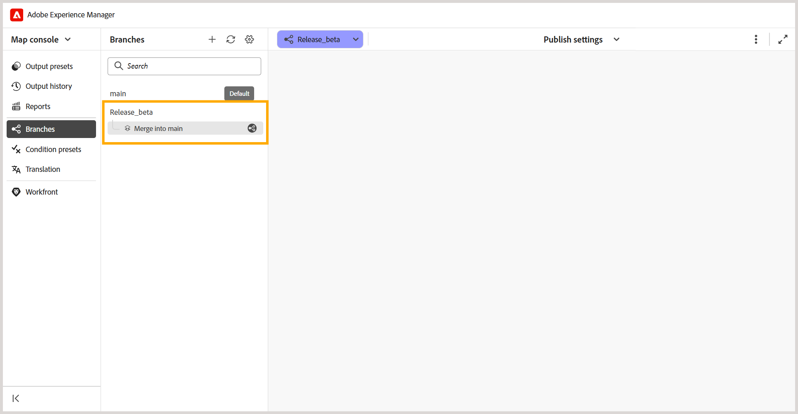

# 将分支合并到主分支

在Experience Manager Guides中，您可以将来自DITA映射分支的更改合并到`main`分支中。 通过合并，您可以将已完成的文档更新合并到`main`中，而无需将更改手动复制到`main`中。

例如，考虑一个名为`install-the-lift.ditamap`的DITA映射，其分支名为`Release 2`。 作者可以更新此分支中的安装说明，而现有文档在`main`中保持不变。

更新准备就绪后，作者可以将更改从`Release 2`合并到`main`中。

## 了解分支合并

合并将更改从DITA映射的选定分支引入`main`分支。

- **Source分支：**&#x200B;包含要合并的更改的分支。
- **目标分支：**&#x200B;更改合并到的默认分支(`main`)。

如果在两个分支中修改了主题/映射的相同部分，则可能会发生合并冲突，需要解决。

## 合并分支

您可以将DITA映射的选定分支中的更改合并到`main`中。

要合并分支，请执行以下步骤：

1. 在“映射”控制台中打开所需的DITA映射。
2. 导航到&#x200B;**分支**&#x200B;选项卡。
3. 找到包含要合并的更改的分支。
4. 打开分支的&#x200B;**选项**&#x200B;菜单，然后选择&#x200B;**合并到主菜单**。

   

   将为所选分支创建合并请求。 它允许您在将更改合并到`main`中之前查看更改并解决任何冲突。

   

5. 选择合并请求。

   合并请求在&#x200B;**合并分支**&#x200B;视图中打开。 查看更改并解决任何冲突（如果需要）。
6. 完成合并。

   查看更改并解决任何冲突（如果需要）。 有关详细信息，请查看[解决合并冲突](#resolve-merge-conflicts)。

   解决所有冲突后，选择&#x200B;**全部合并**&#x200B;以将更改合并到`main`中。

   这些更改将合并到`main`分支中。

## 解决合并冲突

在`main`和要合并的分支中修改了相同的内容时，会发生合并冲突。 在将更改合并到`main`中之前，必须解决所有冲突。

打开合并请求时，**合并分支**&#x200B;视图中会显示以下部分：

- **冲突：**&#x200B;列出需要冲突解决的文件。
- **清理更新：**&#x200B;列出可以合并而不解决冲突的文件。

对于有冲突的文件，将显示&#x200B;**合并分支**&#x200B;视图。

**合并分支**&#x200B;视图包含以下窗格：

- **左窗格（主）：**&#x200B;显示默认分支(`main`)的内容。
- **中间窗格（已合并）：**&#x200B;显示合并的内容，您可以在其中接受分支的更改或直接编辑内容。
- **右侧窗格（选定的分支）：**&#x200B;显示合并到`main`中的分支的内容。

根据&#x200B;**合并**&#x200B;窗格中的内容，左右窗格中会突出显示这些差异：

- **红色(-)：**&#x200B;表示&#x200B;**合并**&#x200B;窗格中存在的内容与相应的左窗格或右窗格中的内容不同。
- **绿色(+)：**&#x200B;表示左窗格或右窗格中存在的、未包含在&#x200B;**合并**&#x200B;窗格中的内容。

最初，**合并的**&#x200B;窗格包含与`main`相同的内容，因此右侧窗格中会突出显示差异。 接受选定分支的更改后，左窗格会显示与更新的&#x200B;**合并**&#x200B;窗格之间的差异。

执行以下步骤来解决合并冲突：

1. 在&#x200B;**冲突**&#x200B;部分中，选择包含冲突的文件。

   >[!NOTE]
   >
   > 在&#x200B;**清理更新**&#x200B;下列出的文件仅包含所选分支中所做的更改，因此不需要解决冲突。

2. 查看&#x200B;**合并分支**&#x200B;视图中突出显示的差异，并使用合并控件解决冲突。

   右侧窗格中冲突旁边的复选框确定如何将所选分支内容添加到&#x200B;**合并**&#x200B;窗格：

   - **已选定（默认）：**&#x200B;将&#x200B;**已合并**&#x200B;窗格中的匹配内容替换为所选分支内容。
   - **已清除：**&#x200B;将所选分支内容与&#x200B;**已合并**&#x200B;窗格中的现有内容一起添加，而不替换它。

   您可以使用以下选项解决冲突：

   - 如果要使用选定分支中的更改，请选中冲突的复选框，然后选择相应的左箭头控件(`<<<`)。 选定的分支内容替换了&#x200B;**合并**&#x200B;窗格中的冲突内容。

     

   - 如果要保留两个分支中的内容，请清除冲突的复选框，然后选择向左箭头控件(`<<<`)。 这会将所选分支内容添加到&#x200B;**已合并**&#x200B;窗格，而不替换该窗格中已存在的内容。

     

   - 如果您已接受所选分支的更改并希望从`main`中恢复相应的内容，请在左窗格中选择右箭头控件(`>>>`)。 这会将&#x200B;**合并**&#x200B;窗格中的选定内容替换为`main`中的版本。

   >[!TIP]
   >
   > 将鼠标悬停在箭头控件上可查看接受所选更改将如何影响&#x200B;**合并**&#x200B;窗格。

3. 查看合并内容后，您还可以使用以下选项之一来接受任一分支的整个内容：

   - **接受主文件：**&#x200B;将所选文件的&#x200B;**合并**&#x200B;窗格中的内容替换为来自`main`的版本。
   - **接受[分支名称]：**&#x200B;将所选文件的&#x200B;**合并**&#x200B;窗格中的内容替换为所选分支中的版本。

   >[!NOTE]
   >
   > 选择任一选项都将替换选定文件的&#x200B;**合并窗格**&#x200B;中的全部内容，包括您在解决冲突时手动所做的任何更改。

   或者，您可以直接在&#x200B;**合并**&#x200B;窗格中查看或编辑内容，然后选择&#x200B;**标记为已解决**&#x200B;以保留合并的内容。

4. 查看&#x200B;**合并**&#x200B;窗格中的最终内容，然后选择&#x200B;**标记为已解决**&#x200B;以将文件标记为已解决。

5. 对&#x200B;**冲突**&#x200B;下列出的所有文件重复这些步骤。

   解决所有冲突后，**合并所有**&#x200B;选项将变为可用。

6. 选择&#x200B;**全部合并**&#x200B;以将已解析的文件和干净更新合并到`main`中。

   >[!NOTE]
   > 
   > 在解决所有冲突之前，**合并所有**&#x200B;选项保持禁用状态。

   已解决的更改将合并到`main`中。 无法撤消已完成的合并。 但是，您可以创建新的合并请求以将后续更改合并到主请求中。

## 管理合并请求

您可以使用上下文菜单管理现有合并请求。

要管理合并请求，请打开其上下文菜单，然后选择以下选项之一：

- **预览：**&#x200B;显示合并请求中的更改而不合并它们。
- **查看日志：**&#x200B;查看与合并请求关联的日志。
- **删除：**&#x200B;删除合并请求。 分支及其更改不受影响。
- **查看报告：**&#x200B;在分支合并到`main`中后查看合并报告。