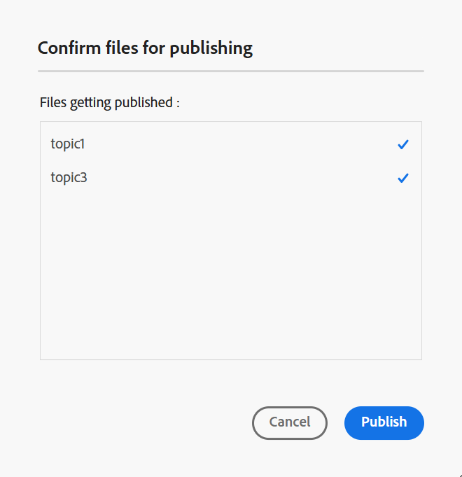
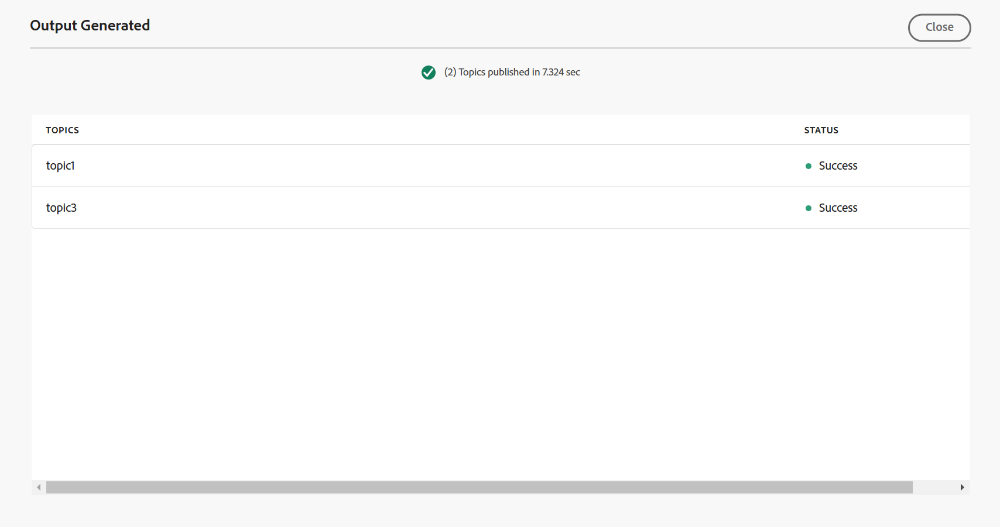
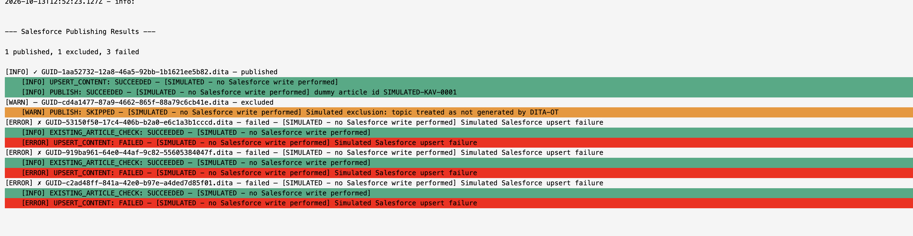

# 生成知识库输出 {#id218CL05J0M1}

Adobe Experience Manager Guides附带基于文章的发布功能，允许用户同时发布一个或多个知识库文章。

此引擎还附带一个OOTB内容模板，该模板基于Adobe Experience Manager核心组件构建，允许用户创建技术内容的基于知识的存储库。 可根据客户的需求自定义此模板。此引擎允许用户以累加方式构建DITA映射，并在准备就绪时发布主题。

如果您仅更新了DITA映射中几个主题的内容，则不必始终发布整个映射。 您只能选择和发布更新的主题。

对于基于文章的发布，您需要为知识库DITA映射创建输出预设。 地图必须包含要发布的主题。 您还可以应用条件并为输出预设指定AEM Sites详细信息。 然后，您可以使用&#x200B;**生成输出**&#x200B;功能生成输出。

执行以下步骤可生成基于文章的输出：

1. [为基于文章的输出创建知识库预设](./generate-output-knowledge-base.md)。
1. 导航到&#x200B;**文章**&#x200B;选项卡，并选择要为其生成输出的主题。

   

   >[!NOTE]
   >
   > 发布到Salesforce时，如果未选择要发布的主题，则&#x200B;**文章**&#x200B;选项卡旁边会显示一个警告图标。 选择一个或多个主题后，警告图标将消失。
1. 选择顶部的&#x200B;**生成输出**&#x200B;以生成输出。
1. 在&#x200B;**确认要发布的文件**&#x200B;提示中，选择要发布的文件，并通过选择&#x200B;**发布**&#x200B;进行确认。

   

   您将查看输出生成过程的状态。 **主题**&#x200B;列列出正在为其生成输出的主题，而&#x200B;**状态**&#x200B;列显示每个主题的发布状态。

   

   要查看输出，请关闭&#x200B;**生成的输出**&#x200B;对话框，然后在预设页面上选择&#x200B;**查看输出**。

   >[!NOTE]
   >
   > 也可以从“选项”菜单中重命名现有输出预设、复制或删除现有输出预设。

## 使用后端处理增强Salesforce发布

从2026.11.0版的Experience Manager Guides as Cloud Service开始，提供了增强的Salesforce发布体验。 它使用后端处理来支持较大的发布作业、提高安全性和解决现有发布过程的问题。

>[!NOTE]
>
> 默认情况下，增强的Salesforce发布体验处于禁用状态。 要启用此功能，请联系Adobe客户成功团队。

在使用增强型Experience将文章发布到Salesforce时，还提供以下附加功能：

- **未选择的主题警告**：未选择要发布的主题时，Salesforce知识库输出预设的&#x200B;**文章**&#x200B;选项卡中出现警告指示符。 选择一个或多个主题后，警告将消失。

  
- **文章级发布状态**：在生成输出后，**Saleforce发布结果**&#x200B;对话框中将显示每篇文章的发布状态（例如“成功”或“失败”）及其主题或文件名。

  

- **发布日志**：使用Salesforce知识库输出预设中的&#x200B;**查看日志**&#x200B;选项查看发布日志并排除错误或警告。

  

  日志还提供了发布结果的摘要。

  
- **输出历史记录**：从&#x200B;**映射控制台**&#x200B;或&#x200B;**Assets UI**&#x200B;查看发布任务的输出历史记录。

  有关管理发布任务的详细信息，请查看[管理输出生成进程](./generate-output-manage-process.md)。

  
- **已优化资源发布：**&#x200B;在将主题发布到Salesforce时，Experience Manager Guides会检查引用的资源（例如多媒体和其他非DITA文件）自上次发布以来是否已被修改。 只再次发布已修改的资源，而跳过未更改的资源。 这减少了冗余资产更新，并提高了发布效率。

### PKCE和刷新基于令牌的身份验证

增强的Salesforce发布体验还支持刷新基于令牌的身份验证，从而减少在访问令牌过期时从Experience Manager Guides重复登录到Salesforce的需求。

>[!NOTE]
>
> 默认情况下禁用刷新令牌支持。 要启用此功能，请联系Adobe客户成功团队。

若要使用此功能，请确保所选OAuth范围中包含了&#x200B;**随时执行请求(refresh_token、offline_access)**，并且在与Salesforce连接的应用程序中启用了&#x200B;**需要代码交换的Proof Key (PKCE)扩展才能支持授权流**。

在Experience Manager Guides中启用刷新令牌支持会自动启用PKCE支持。 但是，还必须在Salesforce中启用相应的设置，身份验证才能成功工作。

**父主题：**[&#x200B;使用编辑器](web-editor.md)
